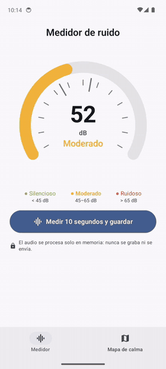
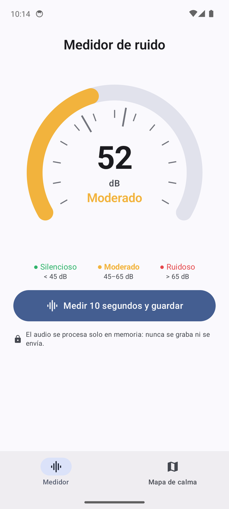
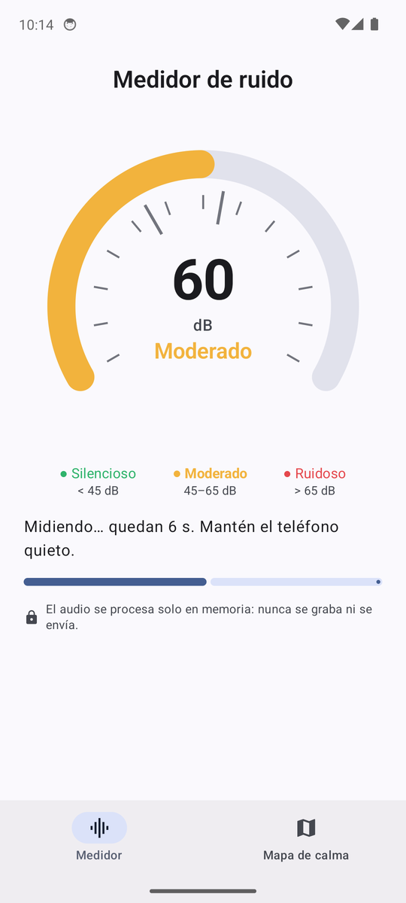
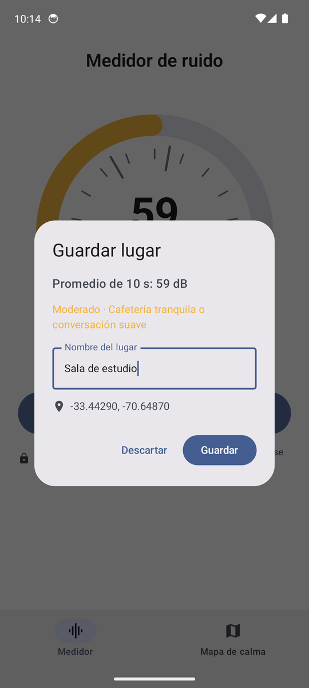
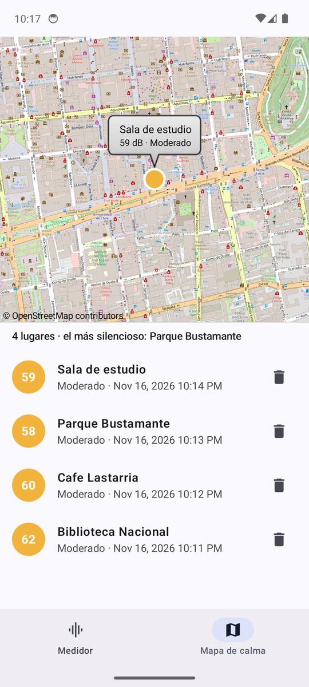

# 🎧 SoundMap — Mapa de calma y medidor de ruido ambiental

[](https://github.com/jsanhuezamolina-ai/app_sound_map/actions/workflows/ci.yml)
[](https://github.com/jsanhuezamolina-ai/app_sound_map/releases/latest)


[](LICENSE)

**SoundMap** es una app nativa para Android, hecha en **Kotlin** y **Jetpack Compose**. Mide el
ruido ambiental en tiempo real, en decibelios, y te permite guardar los lugares tranquilos en un
mapa. Está pensada para estudiantes y personas que trabajan a distancia y buscan dónde concentrarse.

> 🔒 **Privacidad por diseño:** el audio del micrófono se procesa solo en memoria para calcular la
> amplitud (RMS). **Nunca se graba, se guarda ni se envía** ningún archivo de voz o sonido. Los lugares
> guardados quedan solo en el teléfono: no hay cuentas, servidores ni copias en la nube.

<p align="center">
  
</p>

<p align="center">
  <a href="docs/demo.mp4"><b>▶ Ver el video completo (44 s)</b></a> ·
  <a href="https://github.com/jsanhuezamolina-ai/app_sound_map/releases/latest"><b>⬇ Descargar el APK</b></a>
</p>

## 📱 Capturas

| Medidor en tiempo real | Midiendo 10 s | Guardar lugar | Mapa de calma |
| :---: | :---: | :---: | :---: |
|  |  |  |  |

*Capturas tomadas en el emulador de Android Studio (Pixel 6, Android 14) con el micrófono del computador, en una habitación con ruido moderado.*

## 📲 Compatibilidad con Android

| Requisito | Valor |
|---|---|
| **Versión mínima** | **Android 8.0 Oreo** (API 26) |
| **Versión objetivo** | **Android 16** (API 36) |
| Compilación | API 37.2 (exigida por las bibliotecas AndroidX actuales) |
| Hardware | Micrófono (obligatorio) · GPS (opcional, mejora la precisión) |
| Servicios | Google Play Services, para la ubicación |
| Internet | Solo para descargar las teselas del mapa. La medición funciona sin conexión |
| Permisos | `RECORD_AUDIO`, `ACCESS_FINE_LOCATION` / `ACCESS_COARSE_LOCATION`, `INTERNET` |

**Dónde se probó:**

| Dispositivo | Android | Resultado |
|---|---|---|
| Emulador Pixel 6 (x86_64, Google APIs) | 14 (API 34) | ✅ Permisos, medición con micrófono real, guardado con ubicación y mapa |
| Teléfono físico | — | Pendiente |

## ✨ Características

- **Medición acústica en tiempo real.** Indicador circular animado en Compose que muestra los dB y cambia de color:
  - 🟢 **< 45 dB, silencioso:** ideal para estudiar o leer.
  - 🟡 **45–65 dB, moderado:** cafetería tranquila o conversación suave.
  - 🔴 **> 65 dB, ruidoso:** tráfico o ambiente agitado.
- **Muestreo de 10 segundos.** Promedia unas 100 lecturas para que un ruido breve no cambie la clasificación del lugar.
- **Mapa sin costos de API.** Usa **OSMDroid (OpenStreetMap)**: no necesita llaves de Google Maps.
- **Persistencia local sin conexión.** Nombre, dB promedio, fecha y coordenadas se guardan con **Room**.
- **Permisos modernos.** Se piden en tiempo de ejecución, con una explicación previa y una alternativa si se rechazan.
- **Material 3 con Material You.** Usa los colores del fondo de pantalla en Android 12+ y tiene modo oscuro.
- **Uso responsable del micrófono.** Solo está abierto mientras la pantalla del medidor está visible.

## 🛠️ Stack y arquitectura

Patrón **MVVM** con capas separadas, según las recomendaciones de Google:

| Área | Tecnología |
|---|---|
| Lenguaje | 100 % Kotlin 2.4 |
| Interfaz | Jetpack Compose (BOM 2026.09) + Material 3 |
| Asincronía | Coroutines, `Flow` y `StateFlow` |
| Inyección de dependencias | Dagger Hilt 2.60 |
| Base de datos | Room 2.8 (esquema exportado en `app/schemas/`) |
| Audio | `android.media.AudioRecord`, PCM 16 bits, 44,1 kHz, mono |
| Ubicación | `FusedLocationProviderClient` (Play Services Location 21.4) |
| Mapas | OSMDroid 6.1 |
| Build | Gradle 9.9 · AGP 9.5 (Kotlin integrado) · KSP 2.3 · catálogo `libs.versions.toml` |

```text
app/src/main/java/com/jonathan/soundmap/
├── data/
│   ├── local/
│   │   ├── NoiseSpotEntity.kt      # Entidad de Room y conversión al modelo de dominio
│   │   ├── NoiseSpotDao.kt         # Consultas reactivas (Flow)
│   │   └── AppDatabase.kt          # Configuración de Room
│   ├── repository/
│   │   └── NoiseSpotRepository.kt  # Acceso único a los lugares guardados
│   └── sensor/
│       ├── AudioMeterManager.kt    # Captura PCM y cálculo de dB (Flow frío)
│       └── LocationTracker.kt      # Ubicación actual (Fused Location)
├── domain/
│   ├── acoustics/
│   │   ├── NoiseMath.kt            # RMS, dB, promedio y suavizado (Kotlin puro, testeable)
│   │   └── NoiseSampler.kt         # Ventana de medición de 10 s
│   └── model/
│       ├── NoiseLevel.kt           # Silencioso / Moderado / Ruidoso
│       └── NoiseSpot.kt            # Modelo de dominio
├── di/
│   └── AppModule.kt                # Módulos de Hilt (Room, Fused Location)
├── ui/
│   ├── components/
│   │   └── DecibelGauge.kt         # Indicador circular animado (Canvas)
│   ├── screens/
│   │   ├── MeterScreen.kt          # Medidor, permisos y diálogo de guardado
│   │   ├── MeterViewModel.kt
│   │   ├── MapHistoryScreen.kt     # Mapa OSMDroid y lista de lugares
│   │   └── MapHistoryViewModel.kt
│   └── theme/Theme.kt              # Material 3 y colores por nivel
├── MainActivity.kt                 # Navegación inferior: Medidor / Mapa de calma
└── SoundMapApp.kt                  # @HiltAndroidApp
```

## ⚙️ Cálculo acústico

El micrófono entrega bloques de muestras PCM de 16 bits, unos 10 por segundo. Para cada bloque se calcula el valor cuadrático medio (**RMS**):

$$RMS = \sqrt{\frac{1}{N} \sum_{i=1}^{N} x_i^2}$$

Luego se convierte a decibelios con $P_{ref} = 1$, la unidad mínima de amplitud digital:

$$dB = 20 \cdot \log_{10}\left(\frac{RMS}{P_{ref}}\right)$$

Ese valor se limita al rango 0–120 dB.

- **Indicador:** muestra un **suavizado exponencial** (α = 0,25) para que no salte con cada bloque.
- **Lugar guardado:** su valor es la **media de los dB** de los 10 segundos. No se usa el nivel energético (Leq) a propósito: con Leq, un golpe de 0,1 s a 80 dB en una sala a 40 dB daría unos 60 dB y la sala pasaría a "moderada". Con la media queda en 40,4 dB, que refleja mejor lo tranquilo que es el lugar. Hay un test que lo comprueba.

> ⚠️ Los micrófonos de los teléfonos no están calibrados como un sonómetro: los valores son
> **aproximados**, pero sirven para **comparar lugares** con el mismo teléfono.

## 🚀 Cómo ejecutar el proyecto

### Instalar el APK
1. Descarga `SoundMap-1.0.0-debug.apk` desde [Releases](https://github.com/jsanhuezamolina-ai/app_sound_map/releases/latest).
2. Ábrelo en el teléfono y permite **instalar apps de origen desconocido**.

También puedes instalarlo por USB: `adb install -r SoundMap-1.0.0-debug.apk`.

### Compilar desde el código
1. Clona el repositorio:
   ```bash
   git clone https://github.com/jsanhuezamolina-ai/app_sound_map.git
   ```
2. Ábrelo en **Android Studio** (una versión compatible con AGP 9.5) y espera a que Gradle sincronice. No hace falta ninguna API key.
3. Instala la plataforma **Android 37.2** si Android Studio no la descarga solo (SDK Manager → SDK Platforms).
4. Ejecútalo en un **teléfono físico** (recomendado para el micrófono real) o en un emulador con API 26 o superior.

Desde la terminal (JDK 17 o superior):
```bash
./gradlew testDebugUnitTest   # 15 tests del cálculo acústico y del muestreo
./gradlew lintDebug           # análisis estático
./gradlew assembleDebug       # app/build/outputs/apk/debug/app-debug.apk
```

### Consejos para probar en el emulador
- **Micrófono del computador:** *Extended controls → Microphone → "Virtual microphone uses host audio input"*, o `adb emu avd hostmicon`.
- **Ubicación:** *Extended controls → Location*, o `adb emu geo fix <longitud> <latitud>`.
- **Abrir directo en el mapa:** `adb shell am start -n com.jonathan.soundmap/.MainActivity --ei tab 1`.

## 🗺️ Mejoras futuras

- [ ] Calibración manual de la sensibilidad del micrófono según el modelo del teléfono (`NoiseMath.rmsToDb` ya acepta un `calibrationOffset`).
- [ ] Filtros en el mapa por franja horaria (mañana, tarde, noche).
- [ ] Exportar e importar los lugares en JSON o GeoJSON.
- [x] Tests unitarios del cálculo acústico (`NoiseMathTest`, `NoiseSamplerTest`).
- [ ] Pruebas de interfaz en Compose.
- [ ] Versión de publicación firmada (AAB) para Google Play.

## 📝 Notas

- El APK publicado es de **depuración**, firmado con la clave de depuración. Para Google Play hace falta una clave propia.
- Paquete: `com.jonathan.soundmap` · versión 1.0.0 (código 1).
- La especificación original del proyecto está en [`docs/especificacion_original.md`](docs/especificacion_original.md).
- Historial de cambios: [CHANGELOG.md](CHANGELOG.md).

## 📄 Licencia

Proyecto bajo licencia **MIT**. Consulta el archivo [LICENSE](LICENSE).

Los datos del mapa son © [colaboradores de OpenStreetMap](https://www.openstreetmap.org/copyright).
